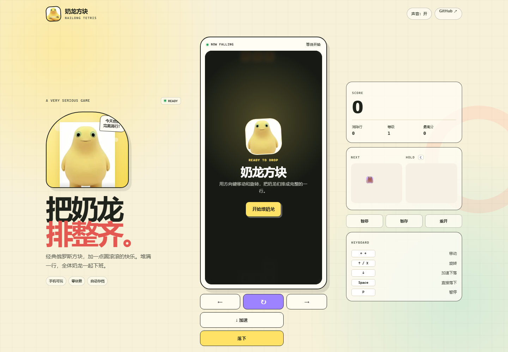

# 奶龙方块 · Nailong Tetris

一个轻量、零依赖、手机可玩的俄罗斯方块小游戏。每个方块都使用奶龙图片作为角色纹理。

> 非官方同人项目。角色图片由项目发起者提供，图片权利及公开使用许可需由发布者自行确认。



## 功能

- 经典 10 × 20 俄罗斯方块棋盘
- 七种方块、旋转、暂存、下一个方块提示
- 手机触控按钮与电脑键盘操作
- 分数、等级、消行数和本地最高分
- 页面隐藏时自动暂停
- 完全静态，无需后端、登录或数据库
- 自动适配桌面和手机

## 运行

项目没有构建步骤。进入项目目录后启动任意静态服务器：

```bash
python -m http.server 8080
```

打开 `http://127.0.0.1:8080`。

## 操作

- `←` / `→`：左右移动
- `↑` 或 `X`：顺时针旋转
- `Z`：逆时针旋转
- `↓`：加速下落
- `Space`：直接落下
- `C`：暂存方块
- `P`：暂停
- 手机可使用棋盘下方的触控按钮

## 测试

使用 Node.js 自带测试运行器：

```bash
node --test tests
```

## GitHub Pages

Play now: <https://weslowdown.github.io/nailong-tetris/>

仓库包含 `.github/workflows/pages.yml`。推送到 `main` 后，在仓库设置中选择
`GitHub Actions` 作为 Pages 来源，即可发布无需安装的网页版游戏。

## 图片许可

`assets/` 中的奶龙角色图片由用户提供，不在 MIT 代码许可证范围内。若将仓库转为
公开，请先确认这些图片的授权、署名和非商业使用要求，或替换为拥有再分发许可的素材。

## 代码许可

源代码使用 MIT License。
